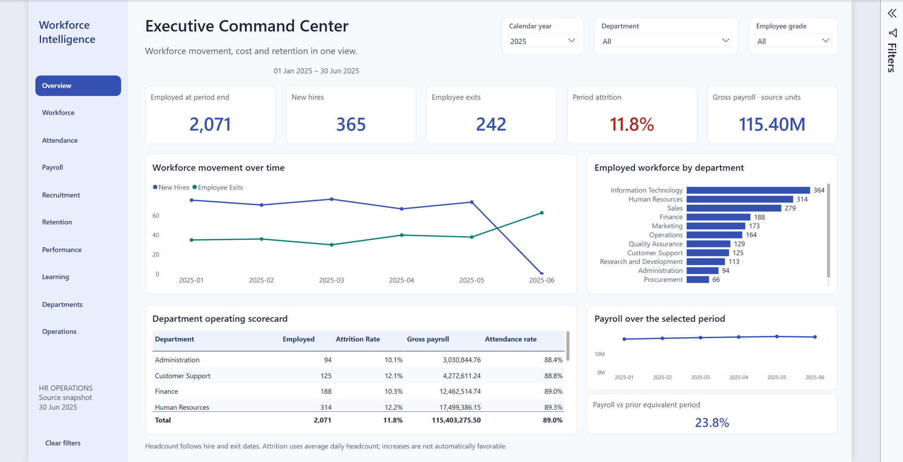
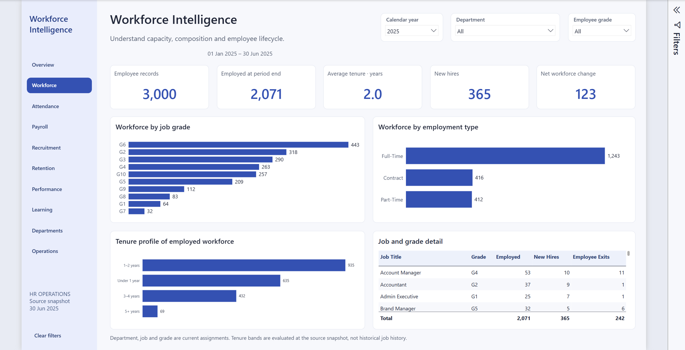
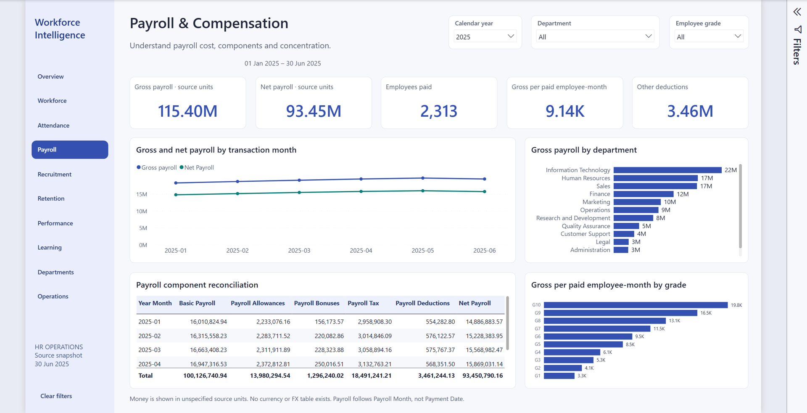
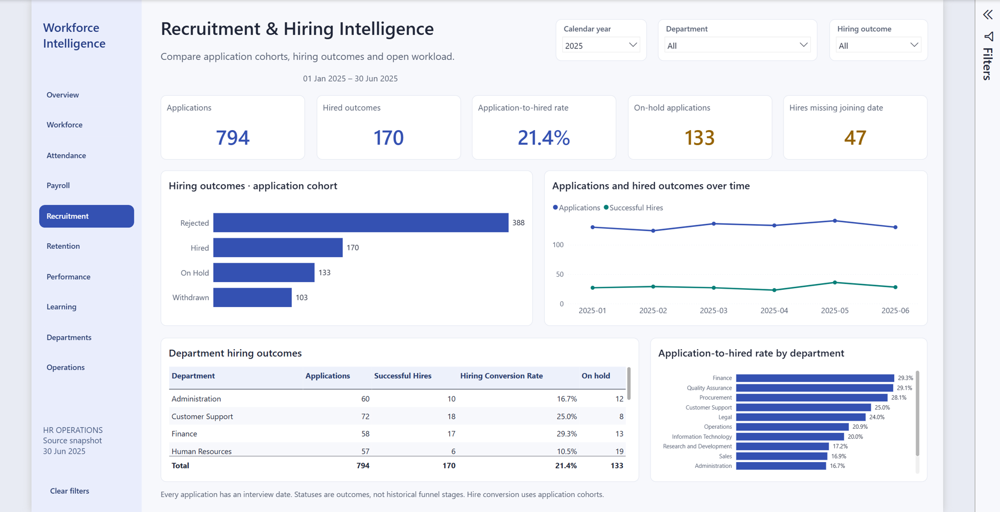
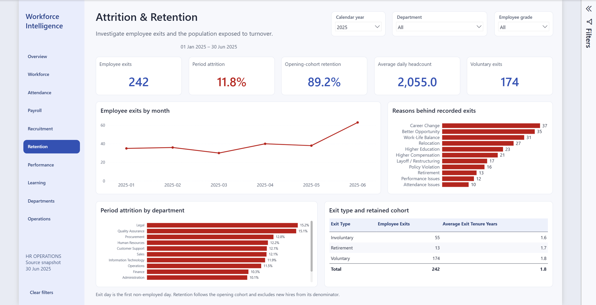
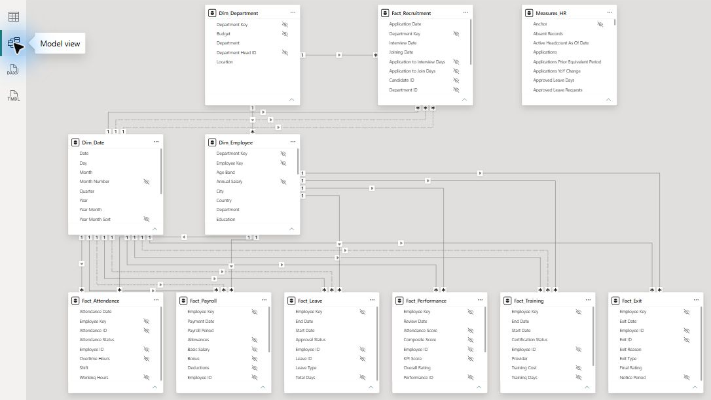

# Workforce Intelligence

### Enterprise HR Operations & Analytics · Power BI

An HR analytics portfolio connecting workforce movement, payroll, recruitment, attendance, performance and learning in one native Power BI report. Built for HR leaders, HR business partners and operations analysts who need consistent definitions across departments and reporting periods.

**[Open the live dashboard ↗](https://app.powerbi.com/view?r=eyJrIjoiMzZhYTVhNWUtNWEwYi00ZTVkLThjOTQtMzRmOTViMWU2MGVlIiwidCI6IjJiYjZlNWJjLWMxMDktNDdmYi05NDMzLWMxYzZmNGZhMzNmZiIsImMiOjl9)** · [Explore the measures](MEASURE_DICTIONARY.md) · [Inspect the model](DATA_MODEL_DICTIONARY.md)



*Executive Command Center — 2025 selected, with the reporting window capped at 30 June 2025. Actual Power BI Desktop capture.*

> **Dataset credit:** The source data was obtained from [Vikash Giri's HR Analytics end-to-end project](https://github.com/vikashGiri27/HR-Analytics-end-to-end-project). The ten CSVs were verified as exact matches to its published files. This repository contains the report, model and documentation; raw records and imported caches are excluded. [Provenance and rights](docs/DATA-SOURCE.md).

## Business problem

HR data is often split across employee records, hiring, payroll, attendance and learning. A count of people who ever appeared in a file is different from headcount on a particular date. Application outcomes do not establish a historical hiring funnel. Unqualified totals can obscure differences in period length or workforce size.

This report brings those domains into a shared analytical model, with explicit date roles, documented denominators and visible reporting context. It supports workforce planning, departmental comparisons, cost analysis and investigation of recorded exceptions.

## What the report does

- **Ten connected analytical pages** with a consistent navigation rail and Material-inspired indigo styling.
- **Year, department and employee-grade slicers**, synchronized where applicable; hiring outcomes filter recruitment independently.
- **Department drill-through** and a contextual department tooltip for moving from a comparison to its supporting detail.
- **67 KPI cards with explanations**, using 40 shared hidden help pages. Every measure also has DAX comments and model Description metadata.
- **120 DAX measures** across workforce, attendance, payroll, recruitment, attrition, performance, training and operations.
- **Editable PBIP/PBIR and TMDL source**, with reusable Power Query transformations and a complete measure dictionary.

## Analytical coverage

| Page | Questions it helps answer |
|---|---|
| Executive Command Center | How are headcount, movement, retention and payroll changing together? |
| Workforce Intelligence | How is the employed workforce distributed across department, grade and tenure? |
| Attendance & Workforce Utilization | What do recorded presence, absence, hours and overtime show? |
| Payroll & Compensation | How do gross pay, deductions and cost per paid employee-month compare? |
| Recruitment & Hiring Intelligence | Which application cohorts convert, and how long do recorded transitions take? |
| Attrition & Retention | How do exits, average daily headcount and opening-cohort retention vary? |
| Performance Intelligence | How are recorded review scores and recommendations distributed? |
| Training & Development | What are participation, completion and training costs? |
| Department Deep Dive | How does one department compare across workforce and cost measures? |
| HR Operations & Exceptions | Which source-record conditions warrant review? |

## KPIs with defined denominators

| Metric | Definition used here |
|---|---|
| Employed headcount | Lifecycle-based headcount at the reporting endpoint; includes employees on leave |
| New hires / employee exits | Employee lifecycle events within the selected period |
| Period attrition | Period exits ÷ exact average daily employed headcount |
| Retention | Opening-cohort members still employed at period end ÷ opening cohort |
| Recorded attendance rate | Present, Late and Half-Day records ÷ recorded employee-days |
| Payroll per employee-month | Gross payroll ÷ paid employee-months |
| Hiring conversion | Observed Hired outcomes ÷ applications in the application cohort |
| Training completion | Completed enrollments ÷ training enrollments |

All definitions, date roles, blanks, units and caveats are in the [measure dictionary](MEASURE_DICTIONARY.md).

## Example analytical readout

For **1 January–30 June 2025**, all departments and grades:

| Workforce movement | Value |
|---|---:|
| Opening headcount | 1,948 |
| New hires | 365 |
| Employee exits | 242 |
| Closing headcount | 2,071 |
| Net workforce change | +123 |
| Average daily headcount | 2,054.97 |
| Period attrition | 11.78% |
| Opening-cohort retention | 89.22% |

The movement reconciles: **1,948 + 365 − 242 = 2,071**. Positive net movement can coexist with departures from the opening cohort. Recruitment outcomes should be evaluated separately: the source provides no candidate-to-employee link. These are descriptive results from the supplied dataset, not causal findings or claims about a real employer.

## Screenshots


*Workforce Intelligence — composition and lifecycle context.*


*Payroll & Compensation — monetary measures are shown in source units, without an assumed currency.*


*Recruitment & Hiring Intelligence — application cohorts and observed outcomes.*


*Attrition & Retention — period exits, average daily headcount and cohort retention.*

See [all ten page screenshots](docs/screenshots/README.md). Every image is captured from the actual report; none is a mockup.

## Technology stack

| Layer | Implementation |
|---|---|
| Report | Microsoft Power BI Desktop; native PBIR visuals and interactions |
| Semantic model | Import mode; TMDL; 3 dimensions, 7 facts and a measure container |
| Calculations | DAX; 120 commented and documented measures |
| Preparation | Power Query M; local CSV sources; parameterized DatasetRoot |
| Modeling | 20 relationships; a marked 2020–2025 date table; active and alternate date roles |
| Validation | Python 3 standard library; Power BI report-authoring CLI; native Desktop review |
| Hosting | Existing Microsoft Power BI Service public report |

This implementation requires no SQL server or Node.js web application. The source repository's MySQL/SQL workflow is credited separately and is not bundled here.

## Project structure

```text
hr-analytics-dashboard/
├── PowerBI-Project/
│   ├── HR Intelligence.pbip
│   ├── HR Intelligence.Report/         # PBIR pages, visuals and resources
│   └── HR Intelligence.SemanticModel/  # TMDL tables, measures and relationships
├── Power-Query/                        # Standalone M companions
├── Themes/                             # Reusable report theme
├── Source-Data/                        # Instructions; data is local and ignored
├── docs/
│   ├── screenshots/                    # Optimized real dashboard captures
│   ├── validation/                     # Provenance and publication checks
│   └── DATA-SOURCE.md
├── scripts/                            # Portable source and package verification
├── MEASURE_DICTIONARY.md
└── DATA_MODEL_DICTIONARY.md
```



## Installation and setup

1. Install Microsoft Power BI Desktop on Windows with support for Power BI Project files. The project has been exercised with Desktop **2.157.1354.0**. Enable the Power BI Project save option if your build requires it.
2. Clone this repository or download its ZIP.
3. Obtain the ten original CSV files from the credited [upstream Database directory](https://github.com/vikashGiri27/HR-Analytics-end-to-end-project/tree/197d1081a261e0167a1002588de142ba5d6f44fd/Database), subject to the source owner's permissions. Place them in `Source-Data/`. File names and verification instructions are in [Source-Data/README.md](Source-Data/README.md).
4. Open `PowerBI-Project/HR Intelligence.pbip` in Desktop.
5. Choose **Transform data → Edit parameters**. Set **DatasetRoot** to the absolute path of your local `Source-Data` folder, without a trailing slash. The saved development path must be updated after cloning.
6. Refresh and save. Imported caches are intentionally absent from Git, so the first refresh populates the model.

Optional source verification uses Python 3.11 or newer, with no pip packages:

```bash
python scripts/verify_data.py Source-Data
python scripts/validate_portfolio.py
```

The report is a Power BI application; there is no `npm start`, frontend lint target or web production build. Schema validation is available separately through Microsoft's `powerbi-report-author` CLI.

## How to use it

Start at **Overview** and select a year, department or grade. Navigate between analytical pages with the left rail. In Desktop edit mode, use **Ctrl+click** on navigation buttons. Hover KPI cards for calculation and interpretation notes. Right-click a department data point and use **Drill through → Department Deep Dive**, then use Back. **Clear filters** resets slicers.

Recruitment has department and application-date context, but no employee linkage; employee-grade filtering does not apply there. See [model policies](docs/Model.md) for date/filter behavior.

## Interpretation boundaries

- The extract ends in **June 2025**; attendance ends 27 June. Partial 2025 totals are not full-year comparisons.
- Historical department/job assignments are unavailable; current attributes classify historical events.
- Attendance uses recorded days, with no scheduled-days denominator. Missing observations are not inferred absences.
- Money is in source units. No currency or exchange rates are supplied.
- Pending leave and On Hold applications are extract statuses, not a live workflow or SLA queue.
- Scores, recommendations and exit reasons support investigation; they do not establish causation or automate employment decisions.

## Validation and deployment

The current source and screenshots are checked in [publication QA](docs/validation/PUBLICATION-QA.md). Earlier engineering evidence recorded 840 exact before/after measure matches and 1,976 semantic checks; those are historical enhancement checks, not fresh Service acceptance results.

The Live Dashboard link reuses the owner's existing Power BI Service publication. It is not hosted by GitHub Pages. Service availability and browser behavior are reported separately from successful local Desktop rendering. No new remote report overwrite is part of this portfolio packaging.

## Author and acknowledgments

**Mohamed Tolba · [@matolba97](https://github.com/matolba97)** — this portfolio's report, semantic modeling, analytical definitions and documentation.

**Source dataset:** [Vikash Giri / HR Analytics end-to-end project](https://github.com/vikashGiri27/HR-Analytics-end-to-end-project). The upstream dataset and project remain the work of their respective contributors. No license for that material is implied by this repository.
