# Actual Power BI report screenshots

Captured in Power BI Desktop on 12 November 2026, after opening the existing saved PBIP. All analytical captures use 2025, all departments and all employee grades. The visible reporting period is 1 January–30 June 2025. Images are proportionally resized PNGs for GitHub; chart values and report content are not retouched.

## Executive Command Center

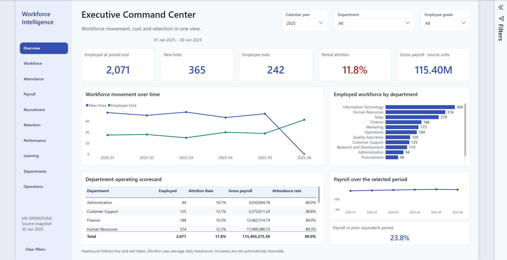

## Workforce Intelligence

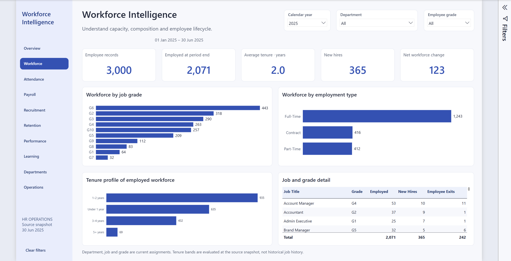

## Attendance & Workforce Utilization

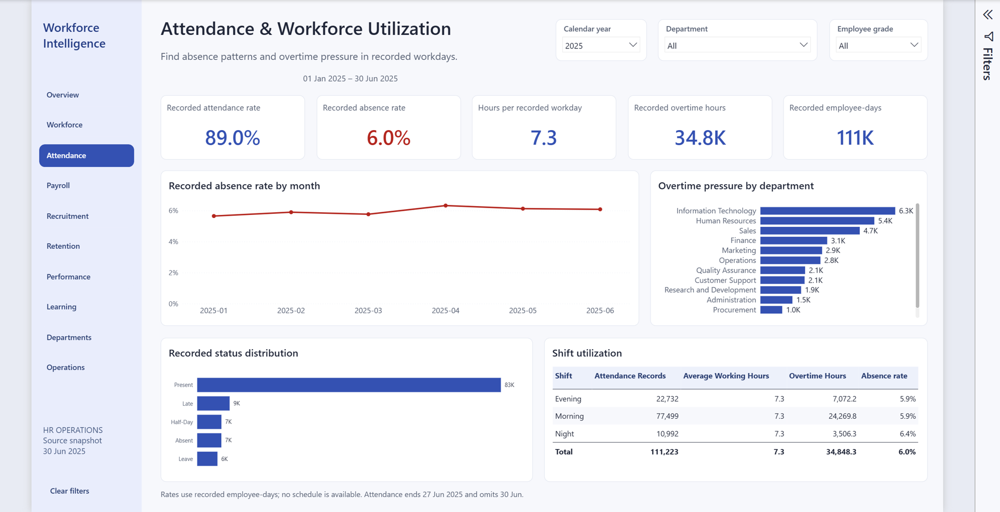

## Payroll & Compensation

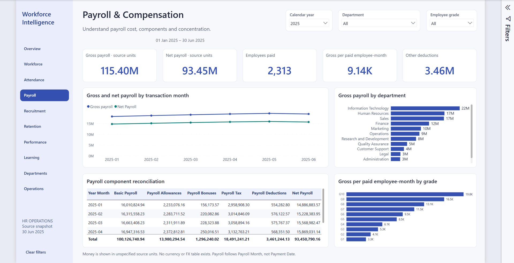

## Recruitment & Hiring Intelligence

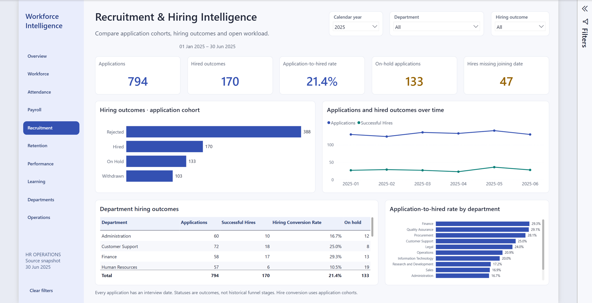

## Attrition & Retention

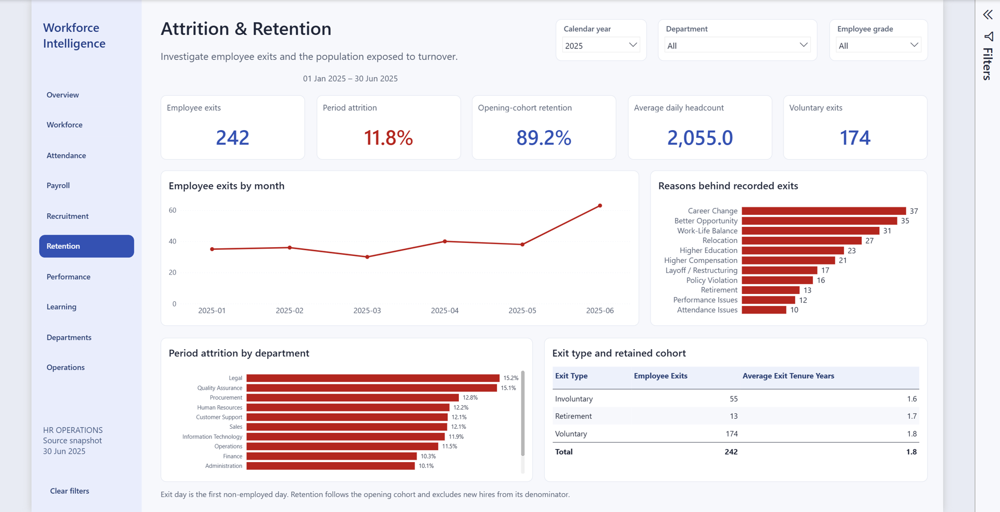

## Performance Intelligence

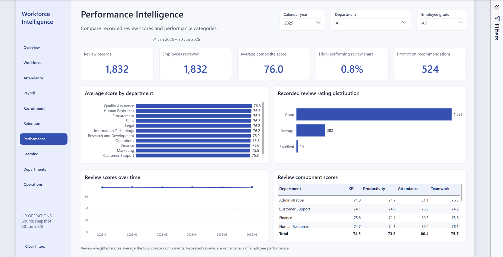

## Training & Development

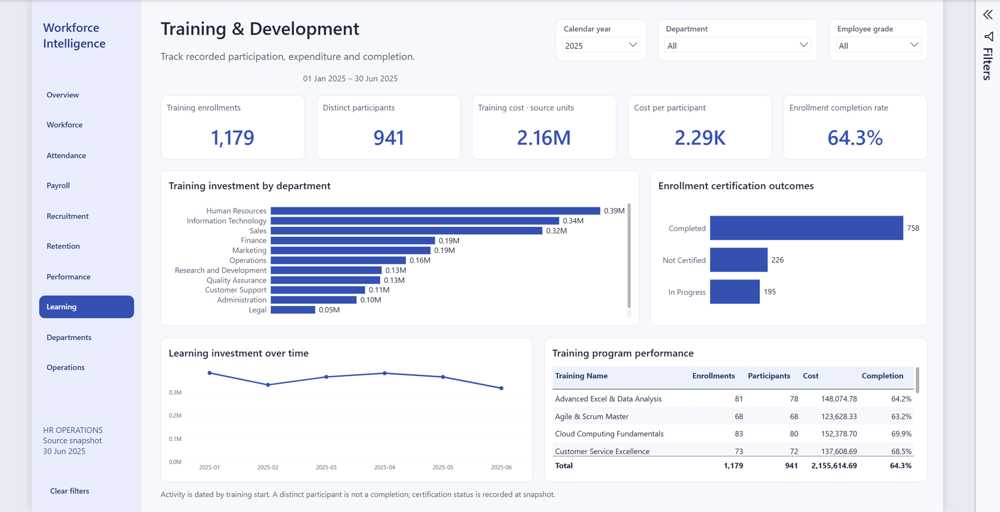

## Department Deep Dive

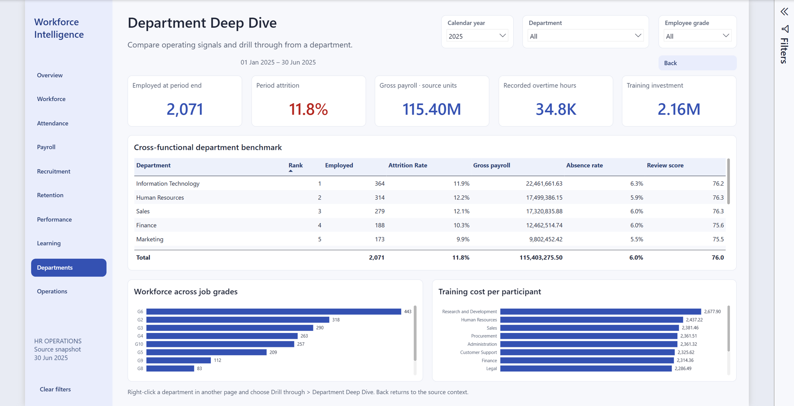

## HR Operations & Exceptions

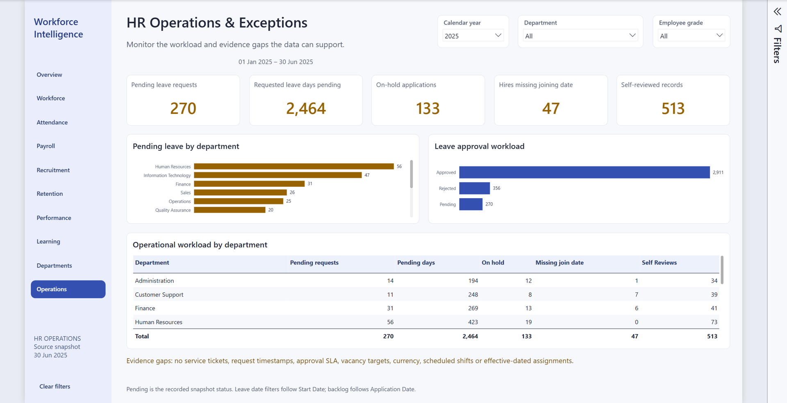

## Live Finance interaction

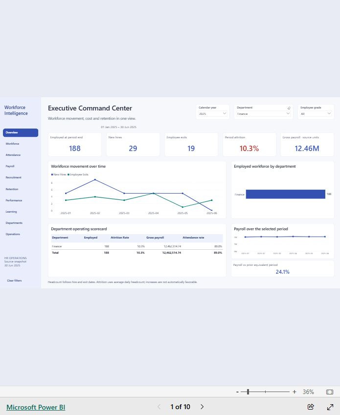

Anonymous production browser check on 12 November 2026: Finance / 2025 returned 188 employed people, 29 hires, 19 exits, 10.3% attrition and gross payroll of 12.46M source units. The Desktop page images above have higher resolution; this image documents the actual browser interaction.
